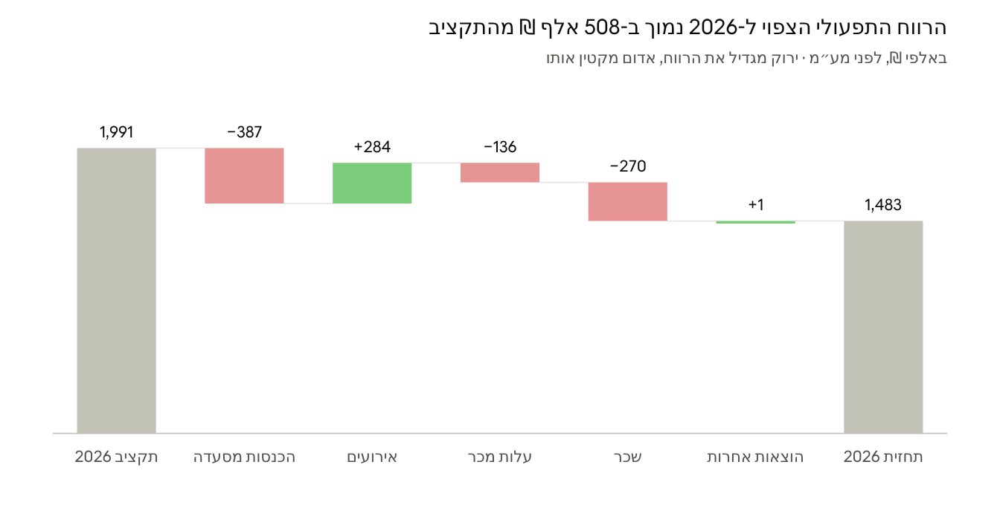
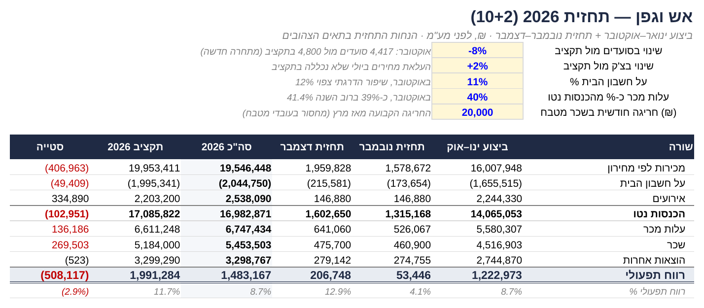
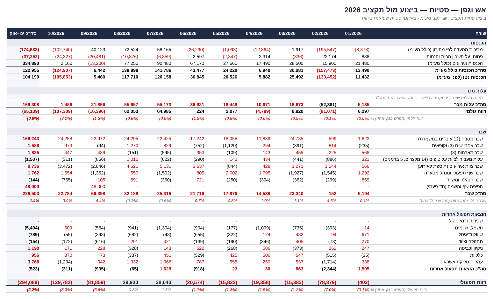
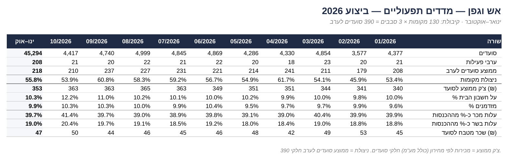

# מודל תכנון ובקרה למסעדת שף: תקציב מול ביצוע ותחזית 2026

**מסעדת "אש וגפן" (שם בדוי)** · Excel · ניתוח סטיות · תחזית מתגלגלת 10+2 · מדדים תפעוליים

> **English summary:** A planning & control (FP&A) model for a 130-seat chef restaurant: monthly P&L actual vs. budget, variance analysis, operational KPIs, and a 10+2 rolling forecast with sensitivity analysis. Built in Excel with fully linked formulas. Data is simulated, based on hands-on experience working in a restaurant.

---

## השאלה העסקית

הבעלים של מסעדת שף רוצים לדעת: **כמה נרוויח השנה, ולמה זה שונה מהתקציב?**
בניתי מודל שמשווה את הביצוע בפועל לתקציב, מסביר כל סטייה ומעריך את הרווח לסוף השנה.

## התוצאה המרכזית

**הרווח התפעולי הצפוי ל-2026 הוא כ-1.48 מיליון ₪, לעומת 1.99 מיליון ₪ בתקציב: נמוך ב-508 אלף ₪ (25%).**

## ממצאים עיקריים

| גורם | השפעה על הרווח | מה קרה |
|---|---|---|
| שכר | −270 אלף ₪ | מחסור בעובדי מטבח הוביל לשעות נוספות, כ-20 אלף ₪ חריגה בחודש מאז מרץ. בנוסף 48 אלף ₪ חד-פעמיים על חפיפת שף תפעולי. |
| הכנסות מסעדה | −387 אלף ₪ | ירידה בפעילות אחרי תקופת לחימה בפברואר, וירידה של 8% בסועדים באוקטובר אחרי פתיחת מתחרה בעיר סמוכה. |
| עלות מכר | −136 אלף ₪ | התייקרות הבשר אצל הספק, ועליית פחת בתקופת ההסתגלות של שף חדש. עלות הבשר עלתה מ-18% ל-20.4% מההכנסות. |
| אירועים | +284 אלף ₪ | יותר אירועים ויותר אורחים מהמתוכנן. זה מנוע הרווח של השנה. |

## המלצות

1. **מעקב שבועי אחרי פחת הבשר:** השוואה בין עלות תקנית לעלות בפועל, עד שהשף החדש מתייצב.
2. **הגדלת הכנסות בימי ראשון עד רביעי:** ניצולת המקומות עומדת על כ-56% בלבד. לפי ניתוח הרגישות, המתחרה עולה למסעדה כ-70 אלף ₪ בחודש, וזה התקציב המקסימלי ההגיוני לתגובה.
3. **הרחבת האירועים בחורף**, שבו מתוכננים רק 4 אירועים בחודש.
4. **בחינת גיוס עובד מטבח נוסף**, במקום שעות נוספות שעולות כ-240 אלף ₪ בשנה.

## מה בניתי

| גיליון | מה הוא עושה |
|---|---|
| **סיכום** | השורה התחתונה, גשר הרווח, מדדים מרכזיים, ממצאים והמלצות |
| **תחזית** | תחזית 10+2 עם הנחות שאפשר לשנות, כולל ניתוח רגישות |
| **סטיות** | ביצוע מול תקציב לכל שורה ולכל חודש, עם סימון אוטומטי של סטיות שפוגעות ברווח |
| **מדדים** | סועדים, ניצולת מקומות, צ'ק ממוצע, Food Cost, שכר מטבח לסועד |
| **דוח רו"ה ביצוע / תקציב** | דוחות רווח והפסד חודשיים, כולם מחושבים בנוסחאות מהנתונים הגולמיים |
| **נתונים גולמיים** | מכירות ברמת מנה, סועדים יומיים, אירועים, רכש מספקים וספירות מלאי |

**עקרונות:** כל מספר מחושב בנוסחה ולא מוקלד ידנית, יש בדיקות התאמה מול הנתונים הגולמיים, ההנחות מרוכזות במקום אחד ומתועדות, ועלות המכר בפועל מחושבת ממלאי פתיחה + רכש − מלאי סגירה.

### תחזית והנחות

### ניתוח סטיות

### מדדים תפעוליים

## הכלים והשיטות

Excel (SUMIFS, COUNTIFS, EOMONTH, עיצוב מותנה) · דוח רווח והפסד · ניתוח סטיות ופירוק מחיר/כמות · תחזית מתגלגלת · ניתוח רגישות · עלות תקנית מול עלות בפועל · מדדי מסעדנות

## על הנתונים

שם המסעדה בדוי. התפריט, המחירים, הקיבולת (130 מקומות, עד 3 סבבים) ודפוסי הפעילות מבוססים על היכרות מהשטח עם מסעדת שף שבה עבדתי. כל הכמויות, העלויות וההוצאות מדומים. הסכומים לפני מע"מ.

## קבצים

- `restaurant_fpa_model_2026.xlsx`: המודל המלא
- `management_summary.pdf`: סיכום בעמוד אחד להנהלה
- קבצי `png`: צילומי מסך

---

**עמית יחיא** · תואר ראשון בניהול מערכות מידע · תואר שני במנהל עבקים

