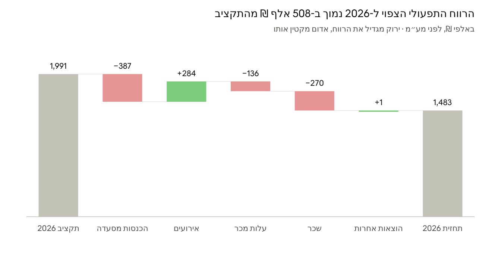
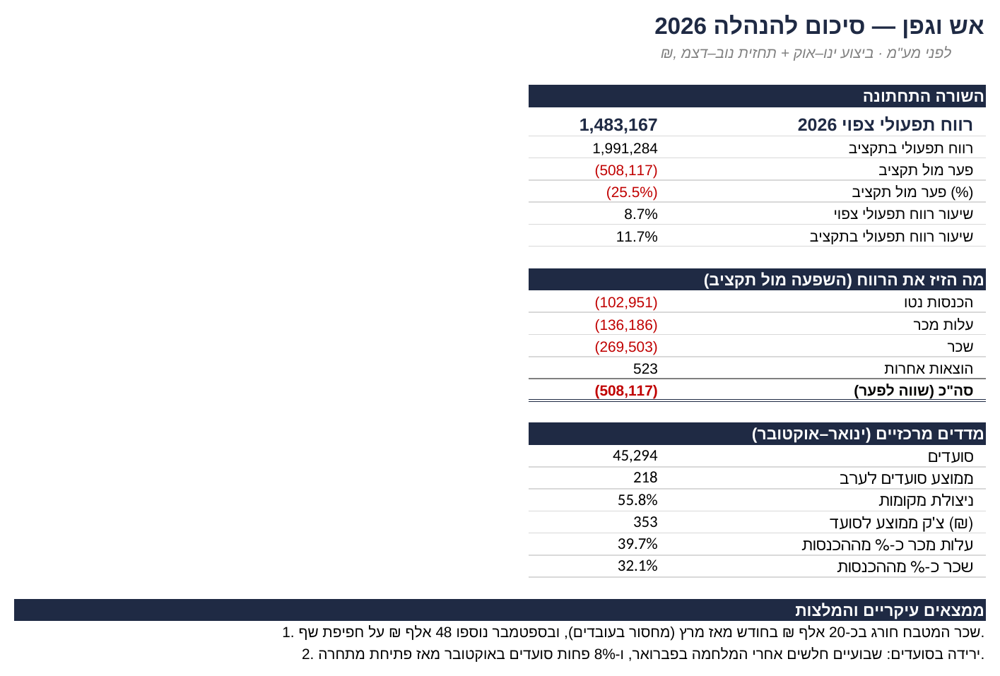
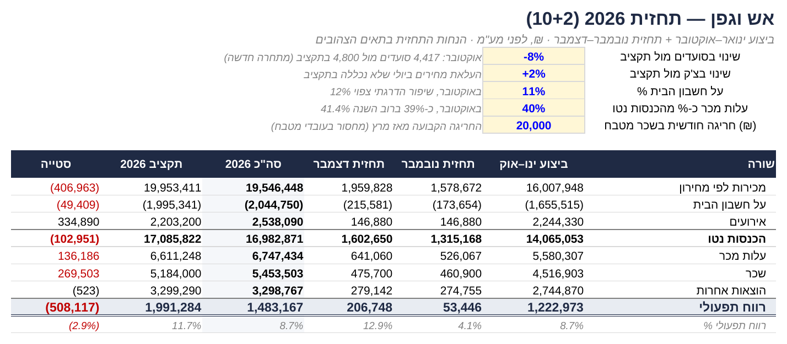
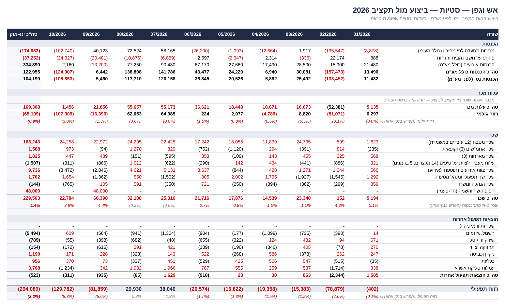
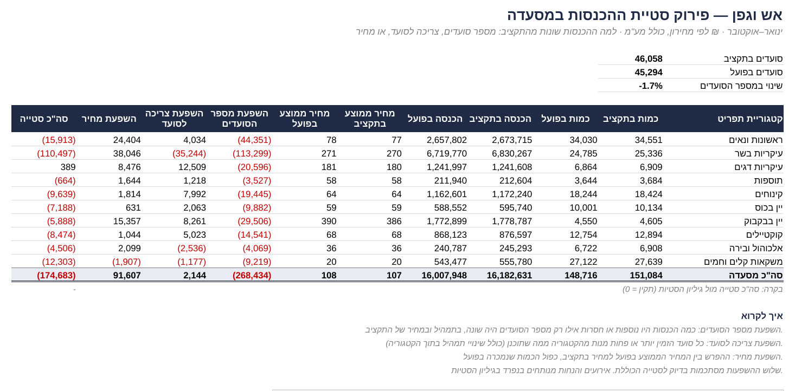
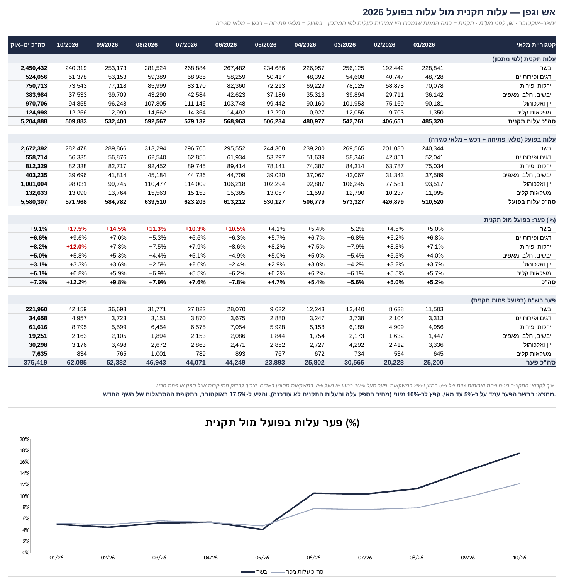
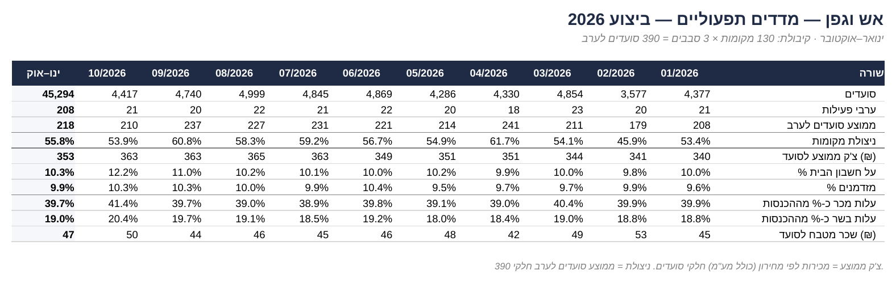

# מודל תכנון ובקרה למסעדת שף: תקציב מול ביצוע ותחזית 2026

**מסעדת "אש וגפן" (שם בדוי)** · Excel · ניתוח סטיות · עלות תקנית מול בפועל · תחזית מתגלגלת 10+2

> **English summary:** An FP&A model for a 130-seat chef restaurant, built in Excel with fully linked formulas: monthly P&L actual vs. budget, variance analysis, revenue variance decomposition (covers / consumption / price), standard vs. actual food cost from inventory counts, operational KPIs, and a 10+2 rolling forecast with sensitivity analysis. Data is simulated, based on three years of hands-on experience managing a restaurant.

---

## השאלה העסקית

בעלי המסעדה רוצים לדעת: **כמה נרוויח השנה, ולמה זה שונה מהתקציב?**
המודל משווה ביצוע לתקציב, מפרק כל סטייה לגורמים שלה, ומעריך את הרווח לסוף השנה.

## התוצאה המרכזית

**הרווח התפעולי הצפוי ל-2026 הוא כ-1.48 מיליון ₪, לעומת 1.99 מיליון ₪ בתקציב: נמוך ב-508 אלף ₪ (25%).**

## ממצאים עיקריים

| גורם | השפעה על הרווח | מה קרה |
|---|---|---|
| שכר | −270 אלף ₪ | מחסור בעובדי מטבח הוביל לשעות נוספות: כ-20 אלף ₪ חריגה בחודש מאז מרץ, ועוד 48 אלף ₪ חד-פעמיים על חפיפת שף. |
| הכנסות מסעדה | −387 אלף ₪ | ירידה של 1.7% במספר הסועדים (תקופת לחימה בפברואר, מתחרה חדשה מאוקטובר) עלתה כ-268 אלף ₪. העלאות המחירים החזירו כ-92 אלף ₪. |
| עלות מכר | −136 אלף ₪ | הפער בין עלות הבשר בפועל לעלות התקנית עלה מכ-5% עד מאי לכ-10% מיוני (התייקרות ספק) ול-17.5% באוקטובר (פחת בתקופת שף חדש). |
| אירועים | +284 אלף ₪ | יותר אירועים ויותר אורחים מהמתוכנן. זה מנוע הרווח של השנה. |

## המלצות

1. **לעדכן את העלות התקנית למחירי הספק החדשים**, כדי שהפער יראה רק פחת אמיתי.
2. **מעקב שבועי אחרי פחת הבשר** עד שהשף החדש מתייצב.
3. **הגדלת הכנסות בימי ראשון עד רביעי:** ניצולת המקומות עומדת על כ-56% בלבד. לפי ניתוח הרגישות, המתחרה עולה למסעדה כ-70 אלף ₪ בחודש, וזה התקציב המקסימלי ההגיוני לתגובה.
4. **הרחבת האירועים בחורף**, שבו מתוכננים רק 4 אירועים בחודש.
5. **בחינת גיוס עובד מטבח נוסף**, במקום שעות נוספות שעולות כ-240 אלף ₪ בשנה.

## מה בניתי

| גיליון | מה הוא עושה |
|---|---|
| **סיכום** | השורה התחתונה, מה הזיז את הרווח, מדדים מרכזיים, ממצאים, המלצות וגרף ביצוע מול תקציב |
| **תחזית** | תחזית 10+2 עם הנחות שאפשר לשנות, כולל ניתוח רגישות |
| **סטיות** | ביצוע פחות תקציב לכל שורה ולכל חודש, עם סימון אוטומטי של סטיות שפוגעות ברווח |
| **פירוק הכנסות** | פירוק סטיית ההכנסות לפי קטגוריית תפריט: מספר סועדים, צריכה לסועד ומחיר |
| **עלות תקנית מול בפועל** | כמה המנות שנמכרו היו אמורות לעלות לפי המתכון, מול מה שנצרך בפועל מהמלאי |
| **מדדים** | סועדים, ניצולת מקומות, צ'ק ממוצע, אחוזי עלות ושכר מטבח לסועד |
| **דוחות רו"ה** | דוחות רווח והפסד חודשיים, ביצוע ותקציב |
| **הנחות וקלטים** | הנחות התקציב, מבנה עלות תקני לכל מנה, קיבולת |
| **נתונים גולמיים** | מכירות ברמת מנה, סועדים יומיים, אירועים, הוצאות, רכש מספקים וספירות מלאי |

**עקרונות:** כל מספר בדוחות מחושב בנוסחה מהנתונים הגולמיים. ההנחות מרוכזות ומתועדות במקום אחד. בכל דוח יש שורות בקרה שמוודאות התאמה לנתונים (תקין = 0).

### סיכום להנהלה

### תחזית והנחות

### ניתוח סטיות

### פירוק סטיית ההכנסות

### עלות תקנית מול עלות בפועל

### מדדים תפעוליים

## הכלים והשיטות

Excel (SUMIFS, SUMPRODUCT, COUNTIFS, EOMONTH, עיצוב מותנה) · דוח רווח והפסד · ניתוח סטיות · פירוק סטייה לסועדים, צריכה ומחיר · עלות תקנית מול עלות בפועל · ספירות מלאי · תחזית מתגלגלת · ניתוח רגישות · מדדי מסעדנות

## על הנתונים

שם המסעדה בדוי. התפריט, המחירים, הקיבולת (130 מקומות, עד 3 סבבים) ודפוסי הפעילות מבוססים על שלוש שנות ניסיון בניהול מסעדת שף. כל הכמויות, העלויות וההוצאות מדומים. הסכומים לפני מע"מ, אלא אם צוין אחרת.

## קבצים

- `restaurant_fpa_model_2026.xlsx`: המודל המלא
- `management_summary.pdf`: סיכום להנהלה
- קבצי `png`: צילומי מסך

---

**עמית יחיא** · מנהלת מסעדה · MBA · תואר ראשון במנהל עסקים ומערכות מידע · [LinkedIn](https://www.linkedin.com/in/amit-yichye/)

